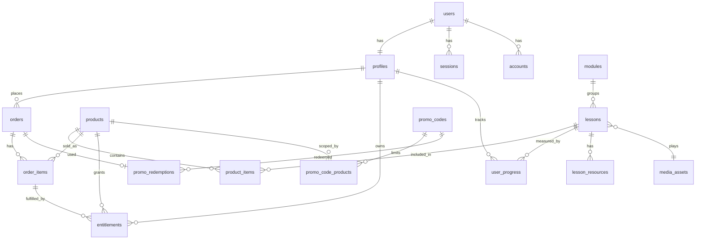

# 03 — Reverse engineering and the v2 architecture

Decisions (2026-10-18): greenfield code in this directory on the same stack family (SvelteKit /
Svelte 5 / Tailwind), keeping the current look and copy; the catalogue sells the whole course, admin
defined bundles and standalone videos; cart checkout; existing lifetime members get everything,
forever.

## Part A — What the current system is

### Domain map (as implemented on `vercel-neon-migration`)

```
users ──1:1── profiles {is_member, is_admin, is_suspended}
                 │ 1:n                 │ 1:n
            user_progress          payments ──n:1── promo_codes
                 │ n:1
modules ──1:n── lessons ──1:n── lesson_resources
                 (video_url = "bunny:<lib>/<video>", content = raw HTML)
pricing_config (one active row = the only price)
blog_posts, testimonials, faq_items, contact_submissions, newsletter_subscribers, site_settings
```

One product, one price, one boolean. Access is `profiles.is_member && !is_suspended` for every
published lesson; `is_free_preview` opens a lesson to everyone.

### Request pipeline

`hooks.server.ts` does, per request: Better Auth `getSession` (1 query), `profiles` lookup
(1 query, self-heals a missing row), `/admin` gate, maintenance flag (1 query unless exempt or
admin), then `svelteKitHandler`, then security headers. Loads and actions re-check authorization
with `isActiveMember` / `isActiveAdmin`.

### Flows

- **Auth**: Better Auth email/password (bcrypt) + Google; sign-in action routes active admins to
  `/admin`; `/auth/redirect` is the post-OAuth router; reset via Resend.
- **Purchase**: checkout action creates the account (if signed out) and signs in → Stripe Checkout
  with ad-hoc `price_data` → webhook and success page both call `recordPaidCheckout` (idempotent
  on `stripe_checkout_session_id`) → `is_member = true`, emails on first recording.
- **Content**: lesson page loads module + lesson + resources + sibling lessons + progress
  (4 queries), builds the Bunny embed URL server-side, optional token signing.
- **Progress**: `POST /api/progress` upsert per lesson; dashboard aggregates in JavaScript after
  loading all modules/lessons/progress.
- **Admin**: one `+page.server.ts` per entity with copy-pasted create/update/delete actions.

### What works against change

| Pain point | Evidence | Effect on the new product |
|---|---|---|
| Business logic lives in route files | `checkout/+page.server.ts` (310 lines) mixes validation, account creation, pricing, promo, Stripe; admin actions repeat slug/order-index/duplicate checks six times | every new product type means another 300-line route; no place to put “grant entitlements for an order” |
| Boolean membership | `profiles.is_member` is the whole access model | cannot express “owns bundle X but not the course” |
| Single price row | `pricing_config` queried in three places by `is_active = true` | no per-product price, no sale price |
| Promo codes are global | `promo_codes` has no product relation; validity predicate defined inside the checkout route | per-product codes impossible without touching checkout internals |
| Video is a string | `lessons.video_url = 'bunny:…'`, duration typed by hand, thumbnails typed by hand | admin cannot browse/upload; standalone videos need a module |
| Hard-coded content facts | `src/lib/data/course-overview.ts` (40 videos, 264 minutes), `FREE_PREVIEW_VIDEO_URL` in the homepage load | stats drift from the database the moment a video is added |
| Two sources of truth for email | `users.email` and `profiles.email` | every lookup must lower-case both; drift is possible |
| No transactions | `neon-http` driver; `db.batch` used in one place | order + items + entitlements + redemption must be atomic |
| Rendering raw HTML | `{@html}` for blog, lesson, FAQ content | security (see audit) and no editor story |
| No domain events / audit | nothing records who changed a price or granted access | admin disputes and refunds are unanswerable |
| Tests cover pure helpers only | 77 tests, none touch a database or a route | regressions in flows go unnoticed until production |
| Documentation drift | `ARCHITECTURE.md` still describes Supabase, RLS and Docker on Bunny containers | onboarding reads the wrong system |

Worth keeping as-is: the access predicates, the payment-ownership rules, the validation parsers,
the hook structure, the design system (Tailwind theme + `app.css` “Editorial Luxury”), the marketing
copy and pages, the email templates' tone, the seed data layout, and the discipline of
“authorization in every load and action”.

## Part B — Target architecture

### Stack

| Layer | Choice | Why |
|---|---|---|
| Framework | **SvelteKit 3.x**, Svelte 5.57+, Vite 8, TypeScript 6+ | greenfield, so no migration cost; SK3 moves config into `vite.config.ts`, replaces `$lib` with `#lib` (package.json `imports`), `$env/*` with typed `$app/env/private|public` declared in `src/env.ts`, drops the Vercel edge runtime (we use Node anyway). Remote functions are still experimental in 3.x: use `load` + form actions at launch, revisit later. Check on day one that `better-auth/svelte-kit` and `@sveltejs/adapter-vercel@7` install cleanly against SK3; fall back to SvelteKit 2.70 only if they do not |
| Styling | **Tailwind CSS 4** (`@theme` tokens in CSS) | port the existing palette (brand / ivory / charcoal / sage / gold), fonts and radii; self-host the two fonts with `@fontsource` |
| Database | Neon Postgres, **Drizzle ORM** with `drizzle-orm/neon-serverless` (`Pool` from `@neondatabase/serverless`, WebSocket) | real `db.transaction()` for order fulfilment; `neon-http` stays available for one-shot reads if latency matters |
| Auth | **Better Auth 1.7+** | already in production after cutover; add `twoFactor` (admins), DB-backed rate limiting, `revokeSessionsOnPasswordReset`, optional `emailOTP` for account claim |
| Payments | **Stripe Checkout** (SDK 23), webhooks, Stripe Tax optional | unchanged provider; add `charge.refunded` handling |
| Video | **Bunny Stream** API + TUS uploads + webhooks; signed embeds mandatory | see `04-admin-offers.md` |
| Validation | **valibot** schemas shared client/server (Standard Schema) | tiny; works with SK form actions and, later, remote functions |
| Forms | SvelteKit form actions + **sveltekit-superforms** | 20+ admin forms; superforms gives typed errors, progressive enhancement and tainted-state handling for free. Keep a 60-line in-house helper as the fallback if the dependency is unwanted |
| Content | Markdown stored, rendered with `marked` + `sanitize-html` at save time into `*_html` columns | removes `{@html}` of untrusted strings; admin keeps a simple textarea with preview |
| Email | Resend HTTP API (no SDK needed) with template functions | unchanged |
| Testing | **Vitest** (pure + services on `@electric-sql/pglite`), **Playwright** E2E on Vercel previews with Stripe test mode | the current suite tests helpers only |
| Observability | `@sentry/sveltekit`, structured JSON logs with a request id, Vercel Analytics | `handleError` already exists; make errors visible |
| Jobs | Vercel Cron (`vercel.json` `crons`) | order expiry, Bunny status poll fallback |

### Modular monolith layout

```
src/
  env.ts                         # SK3 typed env declarations (defineEnvVars)
  hooks.server.ts                # sequence(): securityHeaders, session, profile, maintenance, adminGate
  params.ts                      # route param matchers (uuid, slug)
  lib/
    shared/                      # isomorphic: money.ts, slug.ts, schemas/ (valibot), types.ts
    components/
      ui/ layout/ marketing/ shop/ course/ admin/
    server/
      db/
        index.ts                 # Pool + drizzle; `withTx()`
        schema/index.ts          # re-exports every module's tables for drizzle-kit
      platform/                  # thin adapters, no business rules
        stripe.ts bunny.ts resend.ts ratelimit.ts logger.ts
      modules/
        auth/        schema.ts service.ts (profiles, roles, suspension) access.ts
        catalog/     schema.ts service.ts queries.ts validation.ts   # products, product_items
        media/       schema.ts service.ts bunny-sync.ts              # media_assets
        content/     schema.ts service.ts                            # modules, lessons, resources, progress
        commerce/    schema.ts cart.ts pricing.ts promo.ts orders.ts fulfilment.ts webhooks.ts
        entitlements/ schema.ts service.ts                           # grant, revoke, canAccess
        marketing/   schema.ts service.ts                            # blog, faq, testimonials, newsletter, contact
        admin/       audit.ts settings.ts
      jobs/          expire-orders.ts sync-bunny.ts
  routes/
    (marketing)/  +layout  /  about  blog  faq  testimonials  fabric-library  contact  legal
    (shop)/       catalogue  products/[slug]  cart  checkout  checkout/success|cancel
    (member)/     library  modules  modules/[module]/[lesson]  videos/[slug]  profile  leave-review
    (auth)/       sign-in  forgot-password  reset-password  redirect  oauth  sign-out
    admin/        (dashboard) products videos promotions orders users content/* marketing/* settings
    api/          webhooks/stripe  webhooks/bunny  progress  newsletter  health
```

Rules that keep it modular:

- Routes are thin: parse input with a schema, call one service function, map the result to
  `fail()` / `redirect()`. No Drizzle imports in `src/routes`.
- A module exposes `service.ts` functions and types; other modules import only from there, never
  from each other's `schema.ts` or `queries.ts`. `commerce` depends on `catalog` and `entitlements`;
  `entitlements` depends on `catalog`; nothing depends on `commerce` except routes and webhooks.
- Every service that writes more than one row takes an optional `tx` and runs inside
  `withTx()`.
- Side effects (emails, Bunny calls) happen after the transaction commits, driven by an outbox-style
  `domain_events` table or, simpler at this scale, called from the service after commit with
  failures logged, never inside the transaction.
- Authorization helpers live in `auth/access.ts` and are called at the top of every load, action
  and endpoint, as today. Route groups add a layout guard for UX, never as the only guard.

### Data model



Tables (new or changed; unchanged marketing tables omitted):

- **profiles**: keep `id`, `full_name`, `avatar_url`, `is_admin`, `is_suspended`,
  `suspended_*`, `stripe_customer_id`, `member_since`. Drop `email` (read it from `users`) and
  make `is_member` a derived, read-only convenience maintained by the entitlements service until
  the old branch is retired, then drop it.
- **media_assets**: `id`, `provider` (`bunny`), `library_id`, `video_id`, `title`,
  `duration_seconds`, `status` (`uploading` | `processing` | `ready` | `failed`), `thumbnail_url`,
  `width`, `height`, `created_at`, `updated_at`. One row per Bunny video; unique
  `(library_id, video_id)`.
- **modules**: unchanged plus `is_course_content boolean default true` (future grouping of
  standalone videos into “collections” without making them course content).
- **lessons**: `module_id` **nullable** (null = standalone video), `media_asset_id` (replaces
  `video_url`), `kind` (`video` | `article`), `content_md`, `content_html`, `is_free_preview`,
  `is_published`, `slug` unique globally for standalone lessons (`/videos/[slug]`), unique per
  module for course lessons. `duration_minutes` becomes a view over `media_assets.duration_seconds`.
- **products**: `id`, `slug`, `kind` (`course` | `bundle` | `single`), `access_scope`
  (`all` | `items`), `title`, `tagline`, `description_md/html`, `cover_image_url`,
  `price` (pence), `currency`, `sale_price`, `sale_starts_at`, `sale_ends_at`, `is_published`,
  `is_featured`, `sort_order`, `stripe_product_id` (nullable, optional sync), timestamps.
  Exactly one row has `access_scope = 'all'`: the flagship course. Its price replaces
  `pricing_config`.
- **product_items**: `(product_id, lesson_id)` pk, `sort_order`. Empty for `access_scope = 'all'`.
- **orders**: `id`, `user_id` (RESTRICT), `status` (`pending` | `paid` | `expired` | `refunded` |
  `partially_refunded` | `disputed`), `currency`, `subtotal`, `discount_total`, `total`,
  `stripe_checkout_session_id` unique, `stripe_payment_intent_id`, `promo_code_id`, `created_at`,
  `paid_at`, `expires_at`. Replaces `payments`.
- **order_items**: `id`, `order_id`, `product_id`, `product_title` (snapshot), `list_price`,
  `unit_price`, `discount_amount`, `refunded_amount`.
- **entitlements**: `id`, `user_id`, `product_id`, `order_item_id` nullable, `source`
  (`purchase` | `migration` | `admin_grant` | `gift`), `granted_at`, `revoked_at`,
  `revoke_reason`, `granted_by` (admin id when manual). Unique active entitlement per
  `(user_id, product_id)` via a partial unique index on `revoked_at IS NULL`.
- **promo_codes / promo_code_products / promo_redemptions**: see `05-discounts.md`.
- **webhook_events**: `provider`, `event_id` unique, `type`, `received_at`, `processed_at`,
  `error`. Idempotency store for Stripe and Bunny deliveries.
- **audit_log**: `actor_id`, `action`, `entity`, `entity_id`, `before`, `after` (jsonb),
  `created_at`. Written by admin services (price change, publish, grant, suspend, refund).
- **newsletter_subscribers**: add `confirmed_at`, `confirm_token_hash` for double opt-in.
- **rateLimit**: Better Auth's table (DB-backed rate limiter).

### Access resolution

```
canAccess(user, lesson):
  if lesson.is_free_preview → true
  if !user or user.is_suspended → false
  if user.is_admin → true
  ∃ entitlement e (user_id = user.id, revoked_at IS NULL) joined to product p where
      p.access_scope = 'all'
   OR ∃ product_items pi (pi.product_id = p.id AND pi.lesson_id = lesson.id)
```

One query, indexed on `(user_id, revoked_at)`. For list pages compute `accessibleLessonIds(user)`
once per request (the same query without the lesson filter) and store it on `locals`. Member
navigation shows a lock state per lesson and the cheapest product that unlocks it.

### Purchase flow

```mermaid
sequenceDiagram
  participant B as Buyer
  participant S as Site (checkout action)
  participant DB as Neon (tx)
  participant ST as Stripe
  participant W as Webhook
  B->>S: POST /checkout (cart cookie, promo, account step)
  S->>DB: BEGIN; validate cart & promo (lock code); insert orders(pending), order_items, promo_redemptions; COMMIT
  S->>ST: checkout.sessions.create(idempotencyKey=order.id, line_items, client_reference_id=order.id)
  S-->>B: 303 → Stripe
  ST->>W: checkout.session.completed (paid)
  W->>DB: webhook_events insert (dedupe) → fulfilOrder(order.id)
  Note over W,DB: tx: order.paid, entitlements per item, is_member sync
  W-->>ST: 200
  B->>S: GET /checkout/success?session_id=…
  S->>ST: retrieve session (verify paid, order id)
  S->>DB: fulfilOrder(order.id) (idempotent, same function)
  S-->>B: “You now own …” + links into the library
```

Rules carried over from the current code: the success page never trusts the URL beyond asking
Stripe; a session fulfils exactly one order for exactly one user; emails go out once, after the
first successful fulfilment. New: `fulfilOrder` is the single place that grants access, and
`charge.refunded` / `charge.dispute.created` call `revokeOrder` which revokes the order's
entitlements and marks the order.

Cart rules: products the buyer already owns are removed with a notice; buying the all-access
course removes every other item (it includes them); a bundle whose every lesson is already owned
is not purchasable; the all-access product is suggested when the cart total exceeds its price.

Account step: keep account-first checkout (it is what the ownership rules rely on) but fix the
pre-registration problem: new accounts are created `emailVerified: false`; the paid
`customer_details.email` matching the account verifies it; an existing unverified account with no
orders can be claimed at checkout by a 6-digit email code (Better Auth `emailOTP`), instead of the
dead end “this email is already registered”.

### Request pipeline (hooks)

`sequence(securityHeaders, resolveSession, loadProfile, maintenance, adminGate)`:

- `resolveSession` skips `/api/auth/*` as today; `loadProfile` joins `profiles` and computes
  `locals.access = { isAdmin, isSuspended, allAccess }` in one query.
- `adminGate` requires `is_admin && !is_suspended` and, for admins, a completed 2FA (`twoFactor`
  plugin) — enforced in the hook so form actions are covered.
- Security headers plus a nonce-based CSP (`frame-src https://iframe.mediadelivery.net`,
  `img-src 'self' https://<cdn>`, `script-src 'self' 'nonce-…'`).
- Maintenance mode reads `site_settings` with a 30-second in-memory cache per instance (the
  current code queries on every request; a half-minute delay is acceptable).

### Rendering strategy on Vercel

- Marketing pages (`/`, `/about`, `/faq`, `/blog/*`, `/testimonials`, `/fabric-library`,
  `/catalogue`, `/products/[slug]`) use ISR (`isr: { expiration: 300, bypassToken }`) and are
  revalidated by the admin service after a publish (`x-prerender-revalidate`). They must not read
  the session; the header's signed-in state is hydrated client-side from a tiny `/api/me` call or
  rendered from a cookie-only hint.
- Member, cart, checkout and admin routes are dynamic (`export const config = { isr: false }`).
- Function region = Neon region. Node 22 runtime.

### Taking over production (v2 launch)

1. v2 lives in its own Git repository and its own Vercel project (`skyler-sewing-secrets-v2`),
   connected to the **same** Neon project through the Marketplace integration (or copied env vars),
   running on `beta.<domain>` for weeks while the hardened branch serves `<domain>`.
2. All schema changes are additive and shipped from v2's Drizzle migrations; the old branch keeps
   working because it ignores new tables and the only columns it reads stay in place
   (`profiles.is_member` is kept in sync by v2's entitlement service and by a one-off backfill).
3. Backfill (idempotent SQL scripts in `scripts/backfill/`):
   `media_assets` from distinct `lessons.video_url` → `lessons.media_asset_id`; the flagship
   `products` row from `pricing_config`; `orders` + `order_items` from `payments`; `entitlements`
   (`source = 'purchase'` with the order when a payment exists, `'migration'` otherwise) for every
   `is_member = true` profile; `promo_redemptions` from `payments.promo_code_id`.
4. Launch = move the production domain from the old Vercel project to the v2 project. Rollback =
   move it back. Stripe webhook: add the v2 endpoint before launch; both endpoints receive events,
   both fulfil idempotently; remove the old one after launch.
5. Retire: drop `pricing_config`, `payments`, `profiles.email`, `profiles.is_member`,
   `lessons.video_url` after two weeks.

### Testing strategy

- Unit: pricing/promo arithmetic, access resolution, cart rules, Bunny signature, email templates.
- Service tests on PGlite: fulfilment idempotency, refund revocation, promo caps under concurrency
  (two parallel transactions), entitlement uniqueness.
- E2E (Playwright) on every Vercel preview with a Neon preview branch: sign-in, buy a single video
  with a code (Stripe test card), access granted, buy the course, refund via Stripe CLI event →
  access revoked, admin creates a bundle from Bunny videos.
- Webhook fixtures recorded with `stripe listen` kept under `tests/fixtures`.

### Conventions (for the v2 CLAUDE.md)

Keep the existing ones (TypeScript everywhere, runes, snippets, kebab-case files, snake_case
columns, `fail()`/`error()`/`redirect()`, friendly messages, no `any`). Add: routes never import
Drizzle; services never import SvelteKit (except `error`/`redirect` types via a thin result type);
every write that touches two tables runs in `withTx()`; every admin mutation writes `audit_log`;
every public form has a schema in `lib/shared/schemas`; every webhook handler is idempotent via
`webhook_events`.

## Open points to settle during Phase 1

- Currency: GBP only today. Stripe Checkout can present localised prices with `currency_options`
  on Stripe Prices, which pushes toward syncing products to Stripe; decide before building the
  product table or add `product_prices (product_id, currency, amount)` now (cheap).
- Tax: enabling Stripe Tax changes nothing in our tables but requires a Stripe Tax registration;
  flag for the owner.
- Gifts: `entitlements.source = 'gift'` is in the model; the UI (buy for someone else) is not in
  scope for launch.
